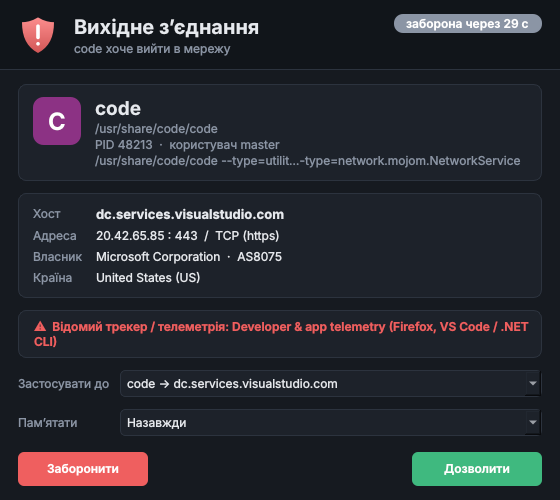
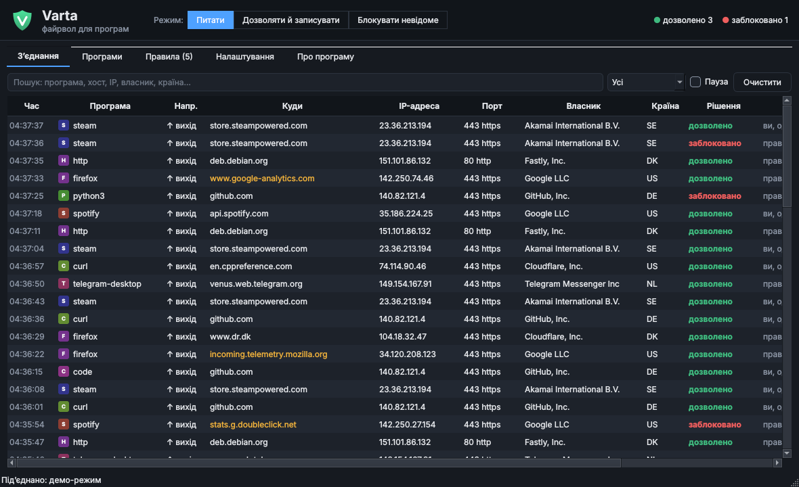
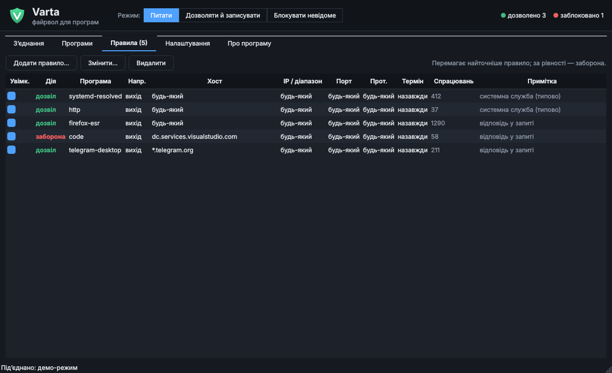

# Varta 🛡️

**Varta** (від «варта») — кросплатформений блокувальник трекінгу й телеметрії на C++17.
Працює на **Linux, macOS і Windows** і використовує те, що вже вбудоване в кожну ОС, —
без драйверів, без фонового демона, без залежностей.

| Що блокується | Як | Linux | macOS | Windows |
|---|---|---|---|---|
| Домени трекерів/телеметрії | керований блок у файлі `hosts` | `/etc/hosts` | `/etc/hosts` | `C:\Windows\System32\drivers\etc\hosts` |
| IP-адреси / діапазони | системний файрвол | nftables (таблиця `inet varta`) | pf (anchor `com.apple/varta`) | Windows Defender Firewall (група правил `Varta`) |
| Небезпечні вхідні порти, ping, DoH, SMB в інтернет | системний файрвол | ✓ | ✓ | ✓ |
| Служба телеметрії Windows | `DiagTrack` + `AllowTelemetry=0` | — | — | ✓ (опційно) |

Усе, що додає Varta, чітко позначене, тому `varta disable` прибирає рівно своє і не чіпає решти.

## Два режими роботи

1. **`varta`** — статичний блокувальник (Linux, macOS, Windows): hosts + системний файрвол. Описаний нижче.
2. **`vartad` + `varta-gui`** — **інтерактивний файрвол для програм (Linux і Windows)**: питає дозволу на кожне
   нове з'єднання, показує, яка програма його відкриває, ім'я хоста, власника IP (організацію, AS) і країну.



---

## Інтерактивний файрвол: vartad + varta-gui

### Як це працює

```
програма ──connect()──► ядро ──NFQUEUE──► vartad ──► є правило? ──так──► дозволити / заблокувати
                                            │                └─ні──► запит у varta-gui ──► ваша відповідь
                                            ├─ /proc: яка програма (PID, шлях, користувач, командний рядок)
                                            ├─ DNS-відповіді: ім'я хоста для IP
                                            ├─ офлайн-база IP: власник (AS, організація) і країна
                                            └─ категорії Varta: чи це відомий трекер / телеметрія
```

- **`vartad`** — служба з правами root / SYSTEM. Вона отримує *перший пакет кожного нового з'єднання*
  і тримає його, доки не буде рішення:
  - **Linux:** nftables `queue` (або iptables NFQUEUE, якщо в ядрі немає nft `queue`);
  - **Windows:** [WinDivert](https://reqrypt.org/windivert.html) 2.2 з офіційним підписаним драйвером.
  Логіка рішень (`daemon/engine.*`) спільна для обох систем; відрізняється лише перехоплення.
  Відповіді DNS лише «підглядаються», щоб знати, до якого хоста належить IP.
- **`varta-gui`** — програма на Qt 6: вікно-запит, іконка в треї, живий журнал з'єднань, статистика
  по програмах, редактор правил, налаштування. З'єднується зі службою через Unix-сокет
  `/run/varta/vartad.sock` (доступ мають лише root і група `varta`).
- **Безпечно за замовчуванням:** правила черги мають прапорець `bypass`, а черга — `FAIL_OPEN`.
  Якщо служба впаде або переповниться, трафік *піде*, а не зависне. `sudo systemctl stop vartad`
  прибирає все одразу.

### Що показує запит

| Поле | Звідки |
|---|---|
| Програма, шлях, PID, користувач, командний рядок | `/proc/net/*` → inode сокета → `/proc/<pid>/fd` → `/proc/<pid>/exe` |
| Хост (`pypi.org`) | перехоплені DNS-відповіді (A/AAAA) |
| Власник IP (`Fastly, Inc. · AS54113`) і країна | офлайн-база [ip-location-db](https://github.com/sapics/ip-location-db) (DB-IP Lite + RouteViews, CC BY 4.0), ~1,2 млн діапазонів |
| ⚠ Трекер / телеметрія | ті самі 10 категорій, що й у `varta` |
| Зворотний DNS | якщо ім'я не видно в DNS — GUI сам робить PTR-запит |

Відповідь можна застосувати до: **лише цього з'єднання**, програма → цей хост, програма → увесь
домен (`*.example.com`), програма → цей IP, програма → цей порт, програма → будь-куди;
**назавжди** або **до перезапуску служби**. Якщо не відповісти за 30 с — спрацює дія за
замовчуванням (заборонити; налаштовується).

### Режими
- **Питати** — запит для кожної невідомої пари «програма → адреса».
- **Дозволяти й записувати** — режим навчання: все дозволено, але журнал пишеться. Зручно перший день,
  щоб зрозуміти, хто куди ходить, і створити правила з журналу (правий клік на рядку).
- **Блокувати невідоме** — все, для чого немає дозвільного правила, блокується без запитань.

### Встановлення на Linux (Debian 13 / Ubuntu)

```bash
sh packaging/install-linux.sh
```
Скрипт ставить залежності (`libnetfilter-queue-dev`, `qt6-base-dev`, `qt6-tools-dev`, `qt6-l10n-tools`…),
збирає, проганяє тести, встановлює в `/usr/local`, створює групу `varta`, завантажує базу IP,
вмикає службу `vartad` і додає GUI в меню та автозапуск. Після цього **один раз вийдіть із сеансу**
й зайдіть знову (щоб застосувалась група). Видалення: `sh packaging/uninstall-linux.sh [--purge]`.

Корисне:
```bash
varta-gui --demo                 # подивитись інтерфейс без служби і без root
sudo vartad --lookup 8.8.8.8     # 8.8.8.8: AS15169 Google LLC, country US
sudo vartad --update-db          # оновити базу IP (оновлюється щомісяця)
sudo vartad --print-nft          # які правила ставить служба
journalctl -u vartad -f          # журнал служби
```

Файли: правила — `/etc/varta/app-rules.json` (по одному на рядок, можна читати руками),
налаштування — `/etc/varta/vartad.conf`, база IP — `/var/lib/varta/ipdb/`.

### Сумісність і обмеження
- **OpenSnitch** використовує ту саму чергу NFQUEUE 0 — одночасно вони не працюватимуть
  (змініть `queue` у `vartad.conf`).
- Статична таблиця `varta` (пріоритет 0) спрацьовує *раніше* за `vartad` (пріоритет 10): заблоковані
  трекери навіть не дійдуть до запиту.
- Програму визначає `/proc`. Процес, який відправив один UDP-пакет і миттєво завершився, може
  встигнути зникнути — тоді в запиті буде «невідома програма» (правило можна зробити лише для адреси).
  Наступний крок — бекенд на eBPF, як в OpenSnitch.
- Ім'я хоста не видно, якщо програма сама шифрує DNS (DoH): тоді показуються IP, власник і країна.
- Великі CDN (Cloudflare, Fastly, Akamai) обслуговують тисячі сайтів, тому «власник IP» там — CDN.
- **macOS** (Network Extension, потрібен платний Apple Developer) — наступний етап.

### Windows: як це влаштовано

| | Як |
|---|---|
| Перехоплення | WinDivert, шар NETWORK: вихідні TCP SYN, вихідний UDP, вхідні TCP SYN. Пакет тримається в пам'яті й повертається в мережу після «Дозволити» — справжнє «затримати й запитати», як на Linux |
| Заборона | для вихідного TCP служба одразу відповідає програмі пакетом RST — вона отримує «з'єднання відхилено» миттєво, а не чекає ~20 с |
| Яка програма | події WinDivert шару SOCKET (bind/connect/accept несуть PID) + таблиці IP Helper (`GetExtendedTcpTable`/`GetExtendedUdpTable`) як запасний варіант; шлях — `QueryFullProcessImageNameW`, користувач — токен процесу, командний рядок — `NtQueryInformationProcess` |
| Ім'я хоста | ті самі DNS-відповіді, лише «підглянуті» через окремий sniff-дескриптор |
| Служба | Windows-служба `vartad` (LocalSystem, автозапуск, перезапуск після збою); журнал — `%ProgramData%\Varta\vartad.log` |
| GUI | `varta-gui.exe` — той самий Qt-інтерфейс; іконки програм беруться прямо з `.exe` |

**Встановлення.** Найпростіше — зібрати пакет на GitHub: після `git push` у вкладці **Actions →
build** з'явиться артефакт **Varta-windows-x64** (vartad, WinDivert, varta-gui з усіма Qt DLL).
Розпакуйте його і двічі клацніть **`install.cmd`** (він сам попросить права адміністратора). Або вручну в PowerShell **від імені адміністратора**:

```powershell
Set-ExecutionPolicy -Scope Process Bypass
.\install.ps1        # перевіряє підпис драйвера, копіює в Program Files, ставить службу, базу IP, ярлики
```
Видалення: `.\uninstall.ps1` (`-Purge` — разом із правилами). Аварійна зупинка: `sc stop vartad`.

**Оновлення.** Готові версії публікуються на сторінці
[Releases](https://github.com/vsavchenko2408/varta/releases) (`Varta-<версія>-windows-x64.zip`).
`varta-gui` раз на день робить один анонімний запит до `api.github.com` і, якщо є новіша версія,
показує вікно з описом змін. Кнопка «Завантажити й встановити» завантажує ZIP, звіряє його
SHA-256 з тим, що публікує GitHub, і запускає той самий `install.cmd` (UAC, заміна файлів,
перезапуск служби). Правила й налаштування в `%ProgramData%\Varta` зберігаються, база IP повторно
не завантажується. Служба пропускає цей запит без питання лише для `varta-gui` з теки Varta і
лише до `github.com`/`*.githubusercontent.com` на порт 443; власне правило «Заборонити» має
пріоритет. Вимкнути перевірку: «Налаштування → Оновлення».

Новий реліз (для розробника): змінити `project(varta VERSION …)` у `CMakeLists.txt`, за бажанням
додати `docs/RELEASE_NOTES_v<версія>.md`, потім `git tag v<версія> && git push --tags`.

Збірка вручну: Visual Studio 2022 + Qt 6.8 (MSVC 2022 64-bit) + розпакований
`WinDivert-2.2.2-A.zip` у `third_party/WinDivert`:
```bat
cmake -S . -B build -G "Visual Studio 17 2022" -A x64 -DCMAKE_PREFIX_PATH=C:\Qt\6.8.3\msvc2022_64
cmake --build build --config Release
ctest --test-dir build -C Release
```

**Обмеження Windows-версії:**
- **svchost.exe.** Багато системних служб Windows працюють усередині `svchost.exe`. Типове правило
  дозволяє його, інакше Windows Update, DHCP, синхронізація часу засипали б запитами. Окремі служби
  всередині svchost поки не розрізняються.
- **UDP.** Кожен вихідний UDP-пакет проходить через службу (у UDP немає «першого пакета», як SYN у TCP);
  вирішені потоки відповідаються з кешу за мікросекунди, але дуже інтенсивний UDP (ігри, відеодзвінки,
  QUIC) трохи навантажує процесор.
- **Вхідний UDP** не запитується — непрохані вхідні з'єднання й так блокує стандартний Windows Firewall.
- **Антивіруси й Memory Integrity.** Деякі антивіруси насторожено ставляться до WinDivert (його
  використовують і легітимні, і шкідливі програми). Якщо служба не стартує, причину видно в
  `vartad.log` (наприклад «driver blocked»).

<p align="center">
  
  
</p>

---

## Статичний блокувальник `varta`: швидкий старт

```bash
# Linux / macOS
sudo varta menu            # інтерактивне меню — найпростіший спосіб
sudo varta apply           # застосувати поточні налаштування
varta status               # що зараз активне
sudo varta disable         # прибрати все

# Windows — у терміналі «Запуск від імені адміністратора»
varta menu
```

Спершу можна подивитися, що саме зміниться, нічого не чіпаючи:

```bash
varta --dry-run apply
varta preview windows      # згенеровані правила для будь-якої ОС
```

## Меню

```
=== Varta menu ===
  1) Blocking categories
  2) Security settings
  3) Security presets (basic / strict / paranoid)
  4) Custom domains, IPs, ports, external lists
  5) General settings (backends)
  6) Save & apply now
  7) Preview generated rules
  8) Download external lists (update)
  9) Disable Varta (remove all rules)
```

Кожен пункт — перемикач `[x]`/`[ ]` з поясненням. Біля категорій написано, що може перестати працювати.

## Категорії блокування

| id | Що | За замовчуванням |
|---|---|---|
| `windows` | Телеметрія Windows (vortex, Watson, telemetry.microsoft.com…) | on |
| `office` | Телеметрія Microsoft Office | on |
| `apple` | Аналітика й рекламні вимірювання Apple | on |
| `google` | Google Analytics, Tag Manager, DoubleClick, AdSense | on |
| `meta` | Facebook pixel / Audience Network (ламає «Увійти через Facebook») | off |
| `analytics` | Mixpanel, Segment, Amplitude, Hotjar, MS Clarity, Yandex Metrika… | on |
| `ads` | Criteo, Taboola, Outbrain, AppNexus, Amazon Ads… | on |
| `nvidia` | Телеметрія GeForce Experience | on |
| `linux` | Ubuntu metrics / popcon, Debian popcon | on |
| `apps` | Телеметрія Firefox, VS Code / .NET CLI | on |

Списки навмисно консервативні: блокуються саме кінцеві точки телеметрії й реклами, а не самі сервіси
(Windows Update, App Store, YouTube працюють). Хочеш агресивніше — підключи зовнішній список:

```bash
sudo varta source-add https://raw.githubusercontent.com/StevenBlack/hosts/master/hosts
sudo varta update && sudo varta apply
```

Підтримуються формати hosts (`0.0.0.0 domain`), «один домен на рядок» і adblock (`||domain^`).

## Налаштування безпеки

| Ключ | За замовч. | Що робить |
|---|---|---|
| `default_inbound_deny` | on | Скидати всі непрохані вхідні з'єднання (відповіді на твої запити проходять) |
| `allow_ssh` | off | Тримати SSH (22/tcp) відкритим |
| `block_ping` | off | Не відповідати на ping |
| `block_smb_netbios` | on | Закрити вхідні 137–139, 445 |
| `block_rdp` | on | Закрити вхідний Remote Desktop 3389 |
| `block_legacy` | on | Закрити Telnet 23 і FTP 21 |
| `block_llmnr_ssdp` | on | Закрити LLMNR 5355 і SSDP/UPnP 1900 |
| `block_mdns` | off | Закрити mDNS 5353 (ламає AirPlay і пошук принтерів) |
| `block_smb_to_internet` | on | Не випускати SMB в інтернет (захист від витоку NTLM-хешів); локальна мережа/NAS працює |
| `block_public_doh` | off | Блокувати DoH/DoT до Cloudflare, Google, Quad9, OpenDNS, AdGuard, щоб браузер не обходив hosts |
| `log_blocked` | off | Логувати відкинуті пакети |

```bash
sudo varta set block_ping on
sudo varta open-port 51820/udp     # наприклад WireGuard
sudo varta allow example.com       # ніколи не блокувати (з піддоменами)
sudo varta block 203.0.113.0/24    # свій IP-діапазон
sudo varta keys                    # усі ключі з поточними значеннями
```

### Пресети

| Пресет | Суть |
|---|---|
| `basic` | Вхідні дозволені, але небезпечні служби (SMB, RDP, Telnet…) закриті |
| `strict` | **Рекомендований.** Вхідні заборонені за замовчуванням + усе з basic |
| `paranoid` | strict + без ping, без mDNS, блок публічних DoH, усі категорії, логування |

Пресет ніколи не видаляє твої відкриті порти й налаштування SSH.

## Автозапуск

Правила nftables і pf не переживають перезавантаження, тому на Linux/macOS:

```bash
sudo varta autostart on     # systemd unit / LaunchDaemon, що робить `varta apply` при старті
```

На Windows правила файрволу й hosts зберігаються самі — нічого робити не треба.

---

## Збірка

Для `varta` потрібні лише компілятор C++17 і CMake ≥ 3.16. `vartad` збирається автоматично, якщо знайдено
`libnetfilter_queue` (тільки Linux), а `varta-gui` — якщо знайдено Qt 6; інакше CMake просто пропускає їх.

**Linux (Debian/Ubuntu)**
```bash
sudo apt install build-essential cmake nftables
cmake -B build -DCMAKE_BUILD_TYPE=Release
cmake --build build -j
./build/varta_tests            # юніт-тести
sudo cmake --install build     # -> /usr/local/bin/varta
```

**macOS**
```bash
xcode-select --install         # компілятор
brew install cmake             # або cmake.org
cmake -B build -DCMAKE_BUILD_TYPE=Release && cmake --build build -j
sudo cmake --install build
```

**Windows** — Visual Studio 2022 (workload «Desktop development with C++»):
```bat
cmake -B build
cmake --build build --config Release
build\Release\varta.exe --help
```

У `dist/` лежать готові бінарники, крос-скомпільовані zig'ом (`varta.exe` для Windows x64 і
`varta-macos-x86_64` для Intel-Mac). Вони компілюються без помилок, але на справжніх Windows і macOS
їх ще не запускали — спершу перевір через `--dry-run`.

## Де що лежить

| | Linux / macOS | Windows |
|---|---|---|
| Конфіг | `/etc/varta/varta.conf` | `%ProgramData%\Varta\varta.conf` |
| Оригінальний hosts (бекап, один раз) | `/etc/varta/hosts.original` | `%ProgramData%\Varta\hosts.original` |
| Завантажені списки | `/etc/varta/lists/` | `%ProgramData%\Varta\lists\` |
| Згенеровані правила | `/etc/varta/generated/` | `%ProgramData%\Varta\generated\` |

Конфіг — звичайний текст з коментарями, його можна редагувати руками (див. `config/varta.conf.example`).

Для тестів без root: `varta --home ./test --hosts ./test/hosts --no-firewall apply`.

---

## Важливі обмеження (чесно)

- **Windows Defender і hosts.** З 2020 року Defender позначає hosts-файли, що блокують сервери
  Microsoft (зокрема `telemetry.microsoft.com`), як `SettingsModifier:Win32/HostsFileHijack` і може
  відкотити зміни. Варіанти: додати hosts у виключення Defender, вимкнути категорію `windows` і
  натомість увімкнути `general.windows_disable_diagtrack` (вимикає службу телеметрії — так надійніше).
- **`AllowTelemetry=0`** повністю діє лише на Windows Enterprise/Education. На Home/Pro Windows
  тримає мінімальний рівень «Required», тому вимикання `DiagTrack` тут важливіше.
- **Hosts не знає wildcard'ів**: `*.example.com` не працює, кожен піддомен треба вказати окремо.
- **DoH у браузерах** (DNS-over-HTTPS) обходить hosts. Увімкни `block_public_doh` або вимкни
  «Secure DNS» у браузері.
- **Блокування за IP** чіпає всі сайти на цьому IP. Тому `resolve_domains_to_ips` вимкнено за
  замовчуванням: трекери часто сидять на спільних CDN.
- **Linux з ufw/firewalld.** Varta додає власну таблицю nftables. Пакет, який відкидає будь-яка
  таблиця, буде відкинутий — `accept` у Varta не відкриває порт, закритий у ufw, і навпаки.
- **macOS pf.** Apple офіційно не вважає pf публічним API (TN3165). Varta вантажить правила в
  піданкер `com.apple/varta`, який підхоплює стандартний `/etc/pf.conf`, сам `pf.conf` не редагується.
- **Windows: вхідні правила застосунків**, які ти вже дозволив раніше («Дозволити доступ»), лишаються
  активними — Varta перемикає лише політику за замовчуванням і додає свої блокувальні правила
  (блок у Windows Firewall завжди сильніший за дозвіл).

## Архітектура (для навчання)

```
daemon/           vartad
  engine.*        спільна логіка: правила, запити до GUI, тайм-аути, історія, протокол JSON
  linux_daemon.*  Linux: NFQUEUE, правила nft/iptables, Unix-сокет, signalfd
  windows_daemon.* Windows: WinDivert, RST для заборон, кеш UDP-потоків, named pipe, служба
  procinfo_win.*  Windows: PID з подій сокетів / IP Helper -> exe, користувач, командний рядок
  packet.*        розбір IPv4/IPv6 + TCP/UDP і DNS-відповідей (зі стисненням імен)
  procinfo.*      Linux: хто власник сокета: /proc/net/* -> inode -> PID -> exe/cmdline/user
  ipdb.*          офлайн-база IP: бінарний пошук по відсортованих діапазонах (IPv6 як 128-біт)
  apprules.*      правила для програм: найточніше правило перемагає, за рівності — заборона
  json.*          маленький JSON-парсер для протоколу з GUI і файлу правил
gui/              varta-gui (Qt 6 Widgets)
  backend.*       клієнт Unix-сокета (JSON по рядку) + демо-бекенд із фейковим трафіком
  prompt.*        вікно-запит
  mainwindow.*    головне вікно, трей, вкладки, редактор правил
  models.*        моделі таблиць (журнал з'єднань, правила)
  style.*         тема, іконки-щити (малюються QPainter), допоміжні функції
  i18n/varta_uk.ts  український переклад (інтерфейс обирає мову системи)
src/
  main.cpp        CLI: розбір аргументів і команди
  app.*           apply / disable / status / update — спільне для CLI та меню
  menu.cpp        інтерактивне текстове меню
  config.*        конфіг: парсер INI, збереження, пресети, таблиця опцій
  blocklists.*    вбудовані категорії доменів, список публічних DoH-резолверів
  rules.*         Config + зовнішні списки -> RuleSet (домени, IPv4, IPv6)
  hosts.*         керований блок у hosts (ідемпотентно, зберігає CRLF)
  firewall.*      генератори nft / pf / PowerShell + застосування для кожної ОС
  net.*           валідація IP/CIDR/доменів/портів, DNS-резолвінг
  platform.*      шляхи, перевірка прав адміністратора, flush DNS, автозапуск
  util.*          рядки, атомарний запис файлів, запуск команд
tests/test_main.cpp, tests/test_daemon.cpp   юніт-тести (без фреймворків)
```

Ключова ідея: генератори правил — **чисті функції** (`RuleSet -> текст скрипта`), тому їх можна
тестувати на будь-якій ОС, а `varta preview windows` працює навіть на Linux.

## Ідеї для наступних версій

- eBPF-бекенд для визначення процесу (надійніше за `/proc`)
- Розрізняти служби всередині `svchost.exe`
- Режим спостереження для macOS; повноцінні запити — через Network Extension
- Перевірка IP за публічними списками шкідливих адрес (abuse.ch, FireHOL)
- Графік трафіку по програмах

Ліцензія: MIT.
